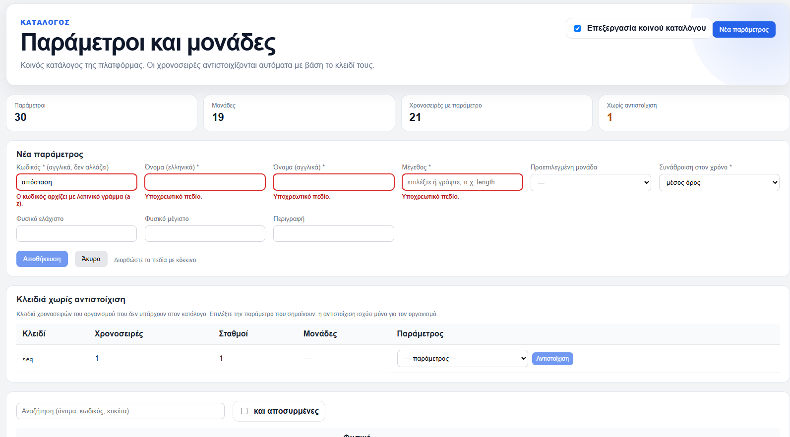
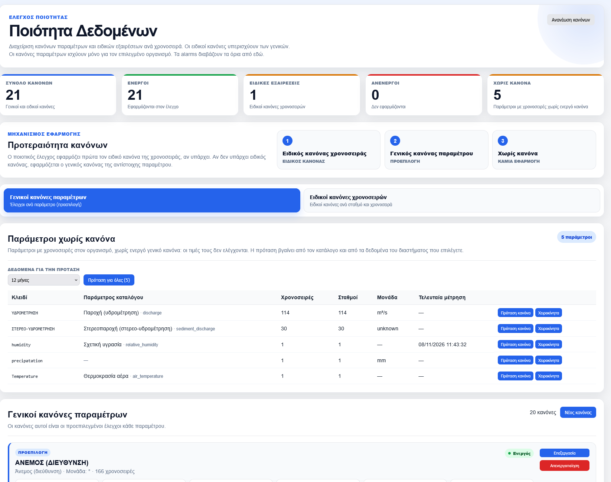
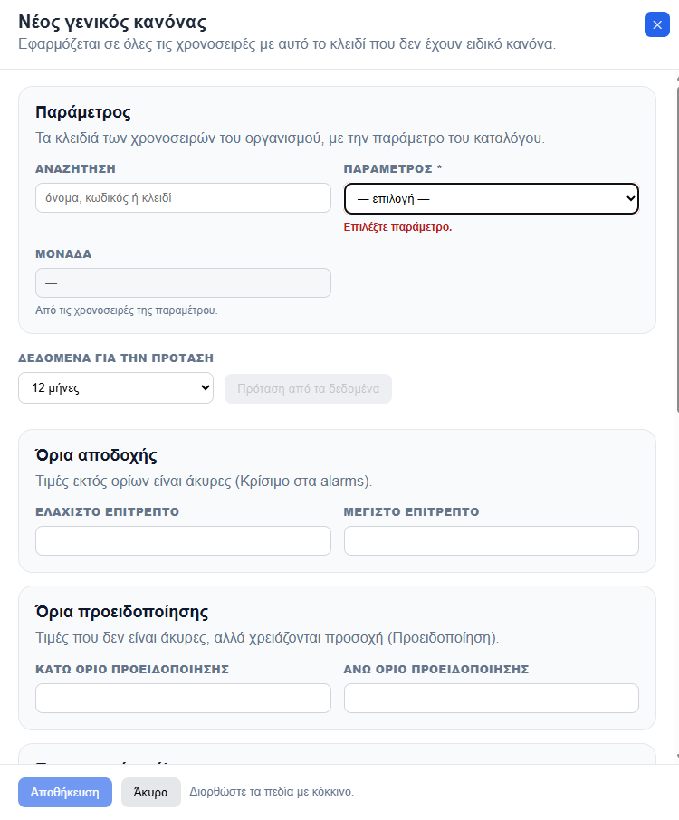
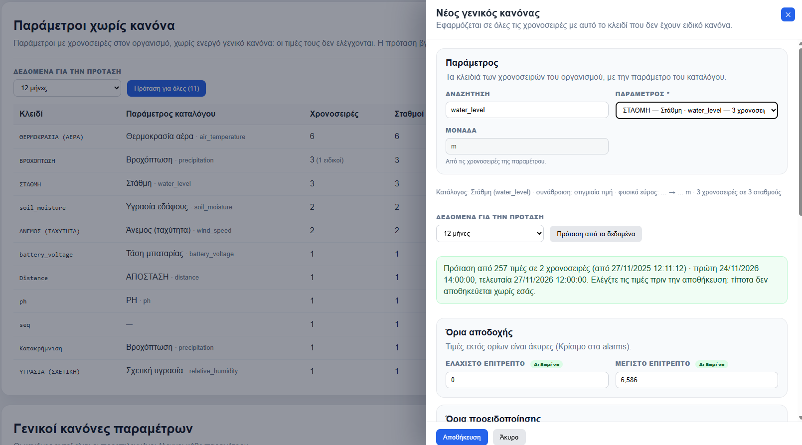
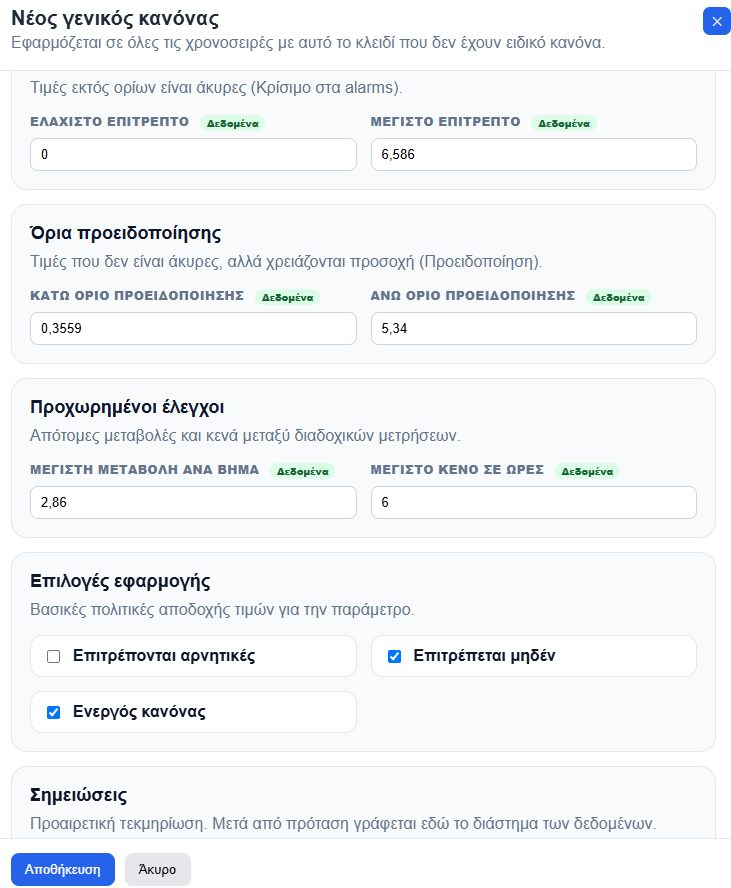
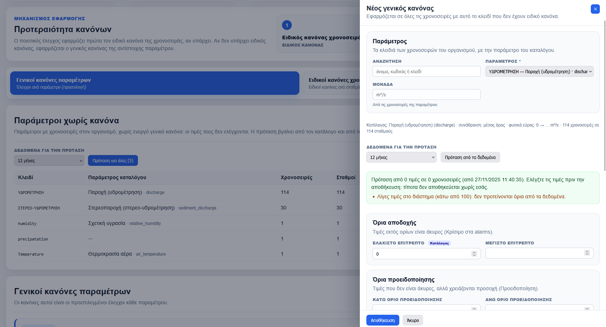
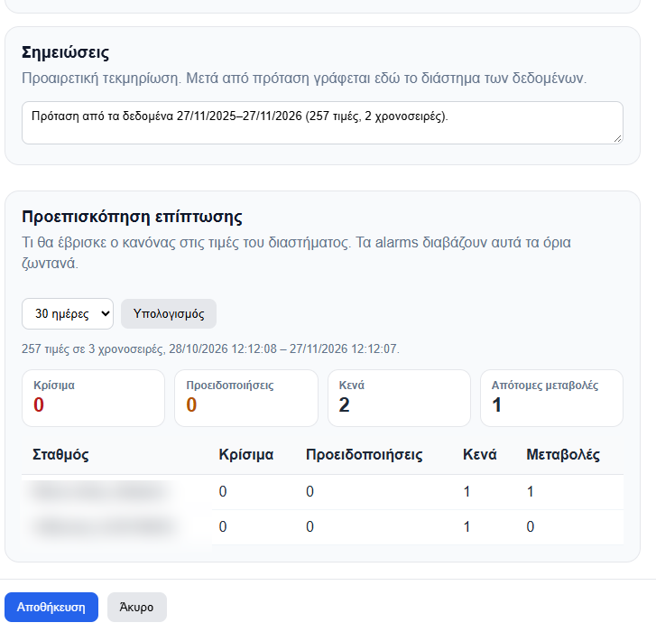
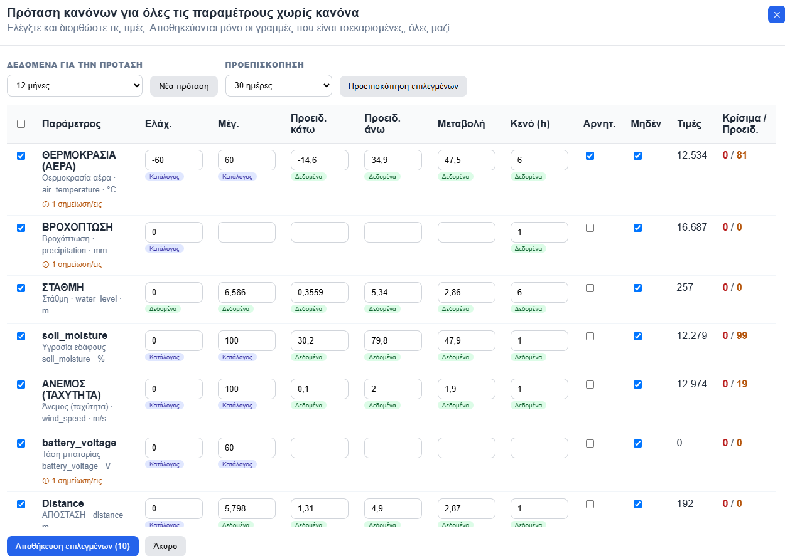
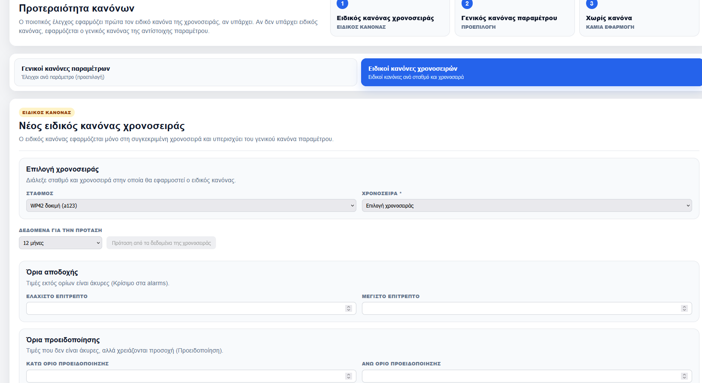
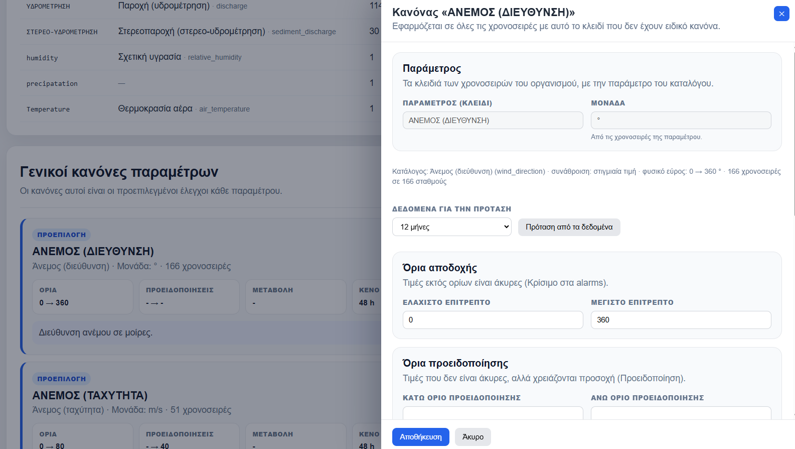

# Ποιότητα δεδομένων και κατάλογος παραμέτρων

Ισχύει για KasPar-IoT **1.7.0** και νεότερες. Ο οδηγός εξηγεί αναλυτικά, με παραδείγματα, πώς στήνεται ο έλεγχος
ποιότητας των μετρήσεων: από τον **κατάλογο παραμέτρων** (τι σημαίνει κάθε κλειδί χρονοσειράς) μέχρι τους **κανόνες
ποιότητας** (ποιες τιμές είναι άκυρες ή ύποπτες) και τη σχέση τους με τα **alarms**.

**Σε ποιον απευθύνεται:**
- **Διαχειριστής οργανισμού (`tenant_admin`):** γράφει τους κανόνες ποιότητας και αντιστοιχίζει τα κλειδιά του οργανισμού στον κατάλογο.
- **Διαχειριστής πλατφόρμας (`platform_admin`):** συντηρεί τον κοινό κατάλογο, δηλαδή τις παραμέτρους, τις μονάδες και τις κοινές ετικέτες.
- **Χειριστές και αναγνώστες:** βλέπουν τους κανόνες και τις προεπισκοπήσεις, αλλά δεν αλλάζουν τίποτα.

Τα screenshots είναι από εγκατάσταση δοκιμών. Τα ονόματα σταθμών έχουν θολωθεί.

## Περιεχόμενα
1. [Οι βασικές έννοιες σε μία σελίδα](#1-οι-βασικές-έννοιες-σε-μία-σελίδα)
2. [Κατάλογος παραμέτρων](#2-κατάλογος-παραμέτρων)
3. [Κανόνες ποιότητας: τα πεδία](#3-κανόνες-ποιότητας-τα-πεδία)
4. [Η σελίδα «Ποιότητα Δεδομένων»](#4-η-σελίδα-ποιότητα-δεδομένων)
5. [Πρόταση από τα δεδομένα](#5-πρόταση-από-τα-δεδομένα)
6. [Προεπισκόπηση πριν την αποθήκευση](#6-προεπισκόπηση-πριν-την-αποθήκευση)
7. [Πρόταση για όλες τις παραμέτρους](#7-πρόταση-για-όλες-τις-παραμέτρους)
8. [Ειδικοί κανόνες χρονοσειρών](#8-ειδικοί-κανόνες-χρονοσειρών)
9. [Παραδείγματα βήμα-βήμα](#9-παραδείγματα-βήμα-βήμα)
10. [Κανόνες ποιότητας και alarms](#10-κανόνες-ποιότητας-και-alarms)
11. [Λίστα ελέγχου για νέο οργανισμό](#11-λίστα-ελέγχου-για-νέο-οργανισμό)
12. [Συχνές ερωτήσεις και προβλήματα](#12-συχνές-ερωτήσεις-και-προβλήματα)
13. [Για developers: API](#13-για-developers-api)

---

## 1. Οι βασικές έννοιες σε μία σελίδα

```
 Συσκευή / αρχείο / εισαγωγή
            │  στέλνει τιμές με ένα ΚΛΕΙΔΙ, π.χ. "ΣΤΑΘΜΗ", "temperature", "Distance"
            ▼
 Χρονοσειρά του σταθμού ── κλειδί + μονάδα (π.χ. ΣΤΑΘΜΗ, m)
            │
            │  ο ΚΑΤΑΛΟΓΟΣ λέει τι σημαίνει το κλειδί:
            │  ΣΤΑΘΜΗ → παράμετρος water_level «Στάθμη», μέγεθος length, συνάθροιση στιγμιαία τιμή
            ▼
 Κανόνας ποιότητας ── ανά ΚΛΕΙΔΙ του οργανισμού (γενικός) ή ανά χρονοσειρά (ειδικός)
            │  όρια αποδοχής, όρια προειδοποίησης, μεταβολή, κενό
            ▼
 Έλεγχος κάθε τιμής:  ok  ·  Προειδοποίηση  ·  Κρίσιμο (άκυρη)
            │
            ▼
 Σελίδα Μετρήσεις, εισαγωγές, ζωντανή λήψη, ALARMS (με email)
```

| Έννοια | Τι είναι | Ποιος το ορίζει |
|---|---|---|
| **Κλειδί** (`parameter_key`) | Το όνομα που έχει η τιμή στη χρονοσειρά, όπως ήρθε από τη συσκευή ή το αρχείο | Η πηγή των δεδομένων |
| **Παράμετρος καταλόγου** | Τι μετριέται: κωδικός (`water_level`), ονόματα, μέγεθος, μονάδα, συνάθροιση, φυσικό εύρος | `platform_admin` (κοινός για όλους) |
| **Ετικέτα** (alias) | Αντιστοίχιση ενός κλειδιού σε παράμετρο: κοινή για όλους ή μόνο για έναν οργανισμό | Κοινή: `platform_admin`. Του οργανισμού: `tenant_admin` |
| **Γενικός κανόνας** | Όρια για όλες τις χρονοσειρές του οργανισμού με ένα κλειδί | `tenant_admin` |
| **Ειδικός κανόνας** | Όρια για μία χρονοσειρά. Υπερισχύει του γενικού, πεδίο προς πεδίο | `tenant_admin` |

> **Σημαντικό:** ο γενικός κανόνας ταιριάζει με το **κλειδί** των χρονοσειρών, όχι με τον κωδικό του καταλόγου. Αν
> ο οργανισμός έχει χρονοσειρές `ΣΤΑΘΜΗ` και `water_level`, χρειάζεται κανόνας για καθένα κλειδί. Η σελίδα δείχνει
> δίπλα σε κάθε κλειδί την παράμετρο του καταλόγου, ώστε να φαίνεται ότι είναι το ίδιο μέγεθος.

---

## 2. Κατάλογος παραμέτρων

Μενού **Δεδομένα → Κατάλογος παραμέτρων**. Ο κατάλογος είναι **κοινός** για όλη την πλατφόρμα. Κάθε οργανισμός βλέπει
τις ίδιες παραμέτρους και μονάδες.

### 2.1 Τα πεδία μιας παραμέτρου

| Πεδίο | Παράδειγμα | Τι κάνει |
|---|---|---|
| **Κωδικός** | `water_level`, `soil_moisture`, `ph` | Μόνιμος αγγλικός κωδικός. **Δεν αλλάζει ποτέ.** Λατινικά πεζά, ψηφία και `_`, αρχίζει με γράμμα, έως 64 χαρακτήρες |
| **Όνομα (ελληνικά / αγγλικά)** | Στάθμη / Water level | Ό,τι βλέπει ο χρήστης |
| **Μέγεθος** | `length`, `temperature`, `ratio`, `ph` | Η φυσική ποσότητα. Ορίζει ποιες μονάδες μετατρέπονται μεταξύ τους. Λατινικά πεζά, ψηφία και `_`, έως 32 χαρακτήρες |
| **Προεπιλεγμένη μονάδα** | m, °C, mm | Η μονάδα στην οποία γράφεται το φυσικό εύρος. Μόνο μονάδες του ίδιου μεγέθους |
| **Συνάθροιση στον χρόνο** | μέσος όρος, άθροισμα, ελάχιστο, μέγιστο, στιγμιαία τιμή | Πώς ενώνονται τιμές σε ωριαίες ή ημερήσιες. Η βροχή είναι **άθροισμα** |
| **Φυσικό ελάχιστο / μέγιστο** | 0 / 14 για το pH | Τι είναι **φυσικά δυνατό**. Από εδώ προτείνονται τα όρια αποδοχής των κανόνων (ενότητα 5) |

### 2.2 Νέα παράμετρος (διαχειριστής πλατφόρμας)

1. Τσεκάρετε **«Επεξεργασία κοινού καταλόγου»** και πατήστε **«Νέα παράμετρος»**.
2. Συμπληρώστε τα πεδία. Η φόρμα ελέγχει τις τιμές καθώς γράφετε:
   - ο **Κωδικός** και το **Μέγεθος** γίνονται αυτόματα πεζά, και τα κενά ή οι παύλες γίνονται `_`: το `Distance` γίνεται `distance` και το `Soil Moisture` γίνεται `soil_moisture`·
   - ελληνικοί χαρακτήρες, ένας αριθμός στην αρχή ή ένα κενό υποχρεωτικό πεδίο δίνουν μήνυμα δίπλα στο πεδίο·
   - η **Αποθήκευση** μένει κλειστή όσο υπάρχουν λάθη.
3. **Μέγεθος:** διαλέξτε από τη λίστα (μεγέθη των μονάδων και των παραμέτρων) ή γράψτε νέο. Ένα νέο μέγεθος, π.χ. `ph`,
   δεν έχει ακόμα μονάδες, οπότε η «Προεπιλεγμένη μονάδα» μένει «—».



*Εικόνα 1. Κωδικός με ελληνικούς χαρακτήρες και κενά υποχρεωτικά πεδία: τα μηνύματα είναι δίπλα σε κάθε πεδίο και η Αποθήκευση είναι κλειστή.*

**Συχνά λάθη:**

| Γράψατε | Τι γίνεται | Σωστό |
|---|---|---|
| `Distance` στον Κωδικό | Γίνεται αυτόματα `distance` | — |
| `απόσταση` στον Κωδικό | «Ο κωδικός αρχίζει με λατινικό γράμμα» | `distance` |
| `2nd_level` | «αρχίζει με λατινικό γράμμα» | `level_2` |
| Κενό Μέγεθος (το «π.χ. length» είναι μόνο υπόδειγμα) | «Υποχρεωτικό πεδίο» | `length` |
| Φυσικό ελάχιστο 10, μέγιστο 5 | «Το φυσικό μέγιστο είναι μικρότερο από το ελάχιστο» | 5 / 10 |

Αλλαγή υπάρχουσας παραμέτρου: «Επεξεργασία» στη γραμμή της. Ο κωδικός δεν αλλάζει, τα υπόλοιπα αλλάζουν. Μια
παράμετρος δεν σβήνεται: με «Απόσυρση» παύει να προτείνεται.

### 2.3 Κλειδιά χωρίς αντιστοίχιση (διαχειριστής οργανισμού)

Όταν μια συσκευή στέλνει κλειδί που ο κατάλογος δεν γνωρίζει (π.χ. `Distance`, `seq`), αυτό εμφανίζεται στον πίνακα
**«Κλειδιά χωρίς αντιστοίχιση»**. Διαλέγετε την παράμετρο που σημαίνει και πατάτε **«Αντιστοίχιση»**. Η αντιστοίχιση:
- ισχύει **μόνο για τον οργανισμό σας**·
- εφαρμόζεται αμέσως σε όλες τις χρονοσειρές με αυτό το κλειδί, και το μήνυμα λέει σε πόσες.

Κλειδιά που δεν είναι μέτρηση (π.χ. `seq`, μετρητής μηνυμάτων) μπορούν να μείνουν χωρίς αντιστοίχιση.

> Η αντιστοίχιση διακρίνει πεζά και κεφαλαία: το κλειδί `Distance` δεν ταιριάζει αυτόματα με τον κωδικό `distance`.
> Χρειάζεται μία φορά «Αντιστοίχιση».

---

## 3. Κανόνες ποιότητας: τα πεδία

| Πεδίο | Τι ελέγχει | Αποτέλεσμα αν παραβιαστεί |
|---|---|---|
| **Ελάχιστο / μέγιστο επιτρεπτό** | Τιμές έξω από αυτά είναι **άκυρες** | **Κρίσιμο** |
| **Επιτρέπονται αρνητικές** (όχι) | Κάθε τιμή < 0 | **Κρίσιμο** |
| **Επιτρέπεται μηδέν** (όχι) | Κάθε τιμή = 0 | **Κρίσιμο** |
| **Κάτω / άνω όριο προειδοποίησης** | Τιμές δυνατές, αλλά ασυνήθιστες | **Προειδοποίηση** |
| **Μέγιστη μεταβολή ανά βήμα** | Η διαφορά από την προηγούμενη τιμή της ίδιας χρονοσειράς | Απότομη μεταβολή |
| **Μέγιστο κενό σε ώρες** | Ο χρόνος από την προηγούμενη τιμή | Κενό (και «Απουσία δεδομένων» στα alarms) |

Η σειρά των ορίων ελέγχεται πριν την αποθήκευση: **ελάχιστο ≤ κάτω προειδοποίηση < άνω προειδοποίηση ≤ μέγιστο**.
Αρνητικό ελάχιστο επιτρέπεται μόνο με τσεκαρισμένο «Επιτρέπονται αρνητικές».

Κενό πεδίο σημαίνει «δεν ελέγχεται». Οι έλεγχοι γίνονται στις **ενεργές τιμές**: αν μια τιμή έχει εγκεκριμένη
διόρθωση, ελέγχεται η διορθωμένη.

---

## 4. Η σελίδα «Ποιότητα Δεδομένων»

Μενού **Δεδομένα → Ποιότητα**.



*Εικόνα 2. Κάρτες σύνοψης, προτεραιότητα κανόνων και «Παράμετροι χωρίς κανόνα».*

- **Κάρτες σύνοψης:** σύνολο, ενεργοί, ειδικοί και ανενεργοί κανόνες, και **Χωρίς κανόνα**: πόσες παράμετροι έχουν χρονοσειρές αλλά κανέναν ενεργό γενικό κανόνα, δηλαδή τιμές που **δεν ελέγχονται**.
- **Προτεραιότητα:** πρώτα ο ειδικός κανόνας της χρονοσειράς, μετά ο γενικός της παραμέτρου, αλλιώς κανένας έλεγχος.
- **Παράμετροι χωρίς κανόνα:** κλειδί, παράμετρος καταλόγου, χρονοσειρές, σταθμοί, μονάδα, τελευταία μέτρηση. Κάθε γραμμή έχει δύο κουμπιά:
  - **Πρόταση κανόνα:** ανοίγει τη φόρμα με την πρόταση ήδη υπολογισμένη (ενότητα 5)·
  - **Χειροκίνητα:** ανοίγει τη φόρμα κενή, με την παράμετρο επιλεγμένη.
- **Κανόνες χωρίς χρονοσειρές:** κανόνες με κλειδί που δεν έχει καμία χρονοσειρά (π.χ. ορθογραφικό λάθος). Δεν εφαρμόζονται πουθενά.
- **Γενικοί κανόνες παραμέτρων:** κάρτα για κάθε κανόνα, με την παράμετρο του καταλόγου και το πλήθος των χρονοσειρών του. Έχει τα κουμπιά «Επεξεργασία» και «Απενεργοποίηση».

### 4.1 Η φόρμα σε πλαϊνό πάνελ

Η φόρμα ανοίγει από τα δεξιά, με «Νέος κανόνας», «Πρόταση κανόνα», «Χειροκίνητα» ή «Επεξεργασία». Κλείνει με ✕ ή Esc.



*Εικόνα 3. Νέος κανόνας: η παράμετρος επιλέγεται από λίστα με αναζήτηση. Χωρίς παράμετρο, η πρόταση και η Αποθήκευση μένουν κλειστές.*

- **Παράμετρος:** λίστα με τα κλειδιά των χρονοσειρών του οργανισμού, π.χ. «ΣΤΑΘΜΗ — Στάθμη · water_level — 3 χρονοσειρές». Η αναζήτηση βρίσκει όνομα, κωδικό ή κλειδί. Οι παράμετροι που έχουν ήδη κανόνα εμφανίζονται τελευταίες, με την ένδειξη «έχει κανόνα». Αν επιλέξετε μία, η φόρμα σας ανοίγει τον υπάρχοντα κανόνα.
- **Μονάδα:** συμπληρώνεται μόνη της, από τις χρονοσειρές της παραμέτρου. Δεν γράφεται.
- Κάτω από την παράμετρο φαίνονται η παράμετρος του καταλόγου, η συνάθροιση, το φυσικό εύρος και πόσες χρονοσειρές και σταθμοί θα ελεγχθούν.

---

## 5. Πρόταση από τα δεδομένα

Η πλατφόρμα προτείνει όρια με βάση τον **κατάλογο** και τις **ίδιες τις μετρήσεις σας**, σε ένα διάστημα που
διαλέγετε. **Δεν αποθηκεύεται τίποτα**: η πρόταση συμπληρώνει τη φόρμα, την ελέγχετε, τη διορθώνετε και μετά
πατάτε Αποθήκευση.

1. **Δεδομένα για την πρόταση:** 3 / 6 / **12** (προεπιλογή) / 24 μήνες, «Όλα τα δεδομένα» ή «Από – έως».
2. **«Πρόταση από τα δεδομένα»**.



*Εικόνα 4. Η πρόταση για τη ΣΤΑΘΜΗ: πόσες τιμές και πόσες χρονοσειρές χρησιμοποιήθηκαν, από πότε έως πότε.*



*Εικόνα 5. Δίπλα σε κάθε πεδίο φαίνεται από πού βγήκε η τιμή: **Κατάλογος**, **Δεδομένα** ή **Προεπιλογή**. Αν αλλάξετε μια τιμή, η ετικέτα φεύγει.*

### 5.1 Πώς υπολογίζεται κάθε πεδίο

| Πεδίο | Πρόταση | Γιατί έτσι |
|---|---|---|
| **Ελάχιστο / μέγιστο** | Το **φυσικό εύρος του καταλόγου**, μετατρεμμένο στη μονάδα της χρονοσειράς (π.χ. 0–14000 mm → 0–14 m). Αν ο κατάλογος δεν έχει εύρος: τιμές από τα δεδομένα, με περιθώριο (βλ. παρακάτω) | Ό,τι είναι φυσικά αδύνατο είναι άκυρο. Τα δεδομένα μόνο όταν δεν υπάρχει γνώση |
| **Κάτω / άνω προειδοποίηση** | Το **0,5%** και το **99,5%** των τιμών (εκατοστημόρια p0.5 και p99.5) | Το 1% των πιο ακραίων τιμών ενός έτους είναι «αξίζει μια ματιά» |
| **Μέγιστη μεταβολή** | Το **99,9%** των διαφορών διαδοχικών τιμών, **μόνο μεταξύ τιμών μέσα στη ζώνη προειδοποίησης** | Μια αιχμή δίνει δύο τεράστιες διαφορές, που δεν πρέπει να γίνουν «κανονικές» |
| **Μέγιστο κενό** | Το συνηθισμένο διάστημα αποστολής (διάμεσος ανά χρονοσειρά, 90% των χρονοσειρών) **× 6**, σε ακέραιες ώρες, τουλάχιστον 1 | Ωριαίες τιμές → κενό 6 ώρες: μία ή δύο χαμένες αποστολές δεν είναι πρόβλημα |
| **Αρνητικές** | Ναι, αν το φυσικό ελάχιστο είναι < 0. Χωρίς κατάλογο, αν υπάρχουν αρνητικές τιμές στο 0,1% των δεδομένων | Θερμοκρασία ναι, στάθμη όχι |
| **Μηδέν** | Ναι, εκτός αν το φυσικό ελάχιστο είναι > 0 | |

**Όρια από τα δεδομένα** (μόνο όταν λείπει το φυσικό εύρος του καταλόγου): το 0,1% και το 99,9% των τιμών, ανοιγμένα
κατά **25%** της μεταξύ τους απόστασης. Ποτέ κάτω από 0 για δεδομένα χωρίς αρνητικές τιμές. Παράδειγμα: με p0.1 = 3
και p99.9 = 11, η απόσταση είναι 8 και το 25% της είναι 2, άρα τα όρια βγαίνουν 1 και 13.

Χρησιμοποιούνται εκατοστημόρια και όχι το ελάχιστο και το μέγιστο, ώστε οι ήδη λάθος τιμές να μη γίνουν «κανονικές».

### 5.2 Ειδικές περιπτώσεις

Εμφανίζονται ως σημειώσεις κάτω από την πρόταση:

| Σημείωση | Τι σημαίνει | Τι προτείνεται |
|---|---|---|
| **Λίγες τιμές** (< 100 στο διάστημα) | Δεν φτάνουν για στατιστική | Μόνο ό,τι δίνει ο κατάλογος. Δοκιμάστε μεγαλύτερο διάστημα ή «Όλα τα δεδομένα» |
| **Αθροιστική παράμετρος** (π.χ. βροχόπτωση) | Πολλά μηδενικά και σπάνιες κορυφές | Χωρίς προειδοποιήσεις, μεταβολή ή μέγιστο από τα δεδομένα: μια μεγαλύτερη καταιγίδα από όσες είχε το διάστημα δεν είναι λάθος |
| **Χωρίς παράμετρο καταλόγου** | Το κλειδί δεν έχει αντιστοιχιστεί | Μόνο από τα δεδομένα. Προτιμήστε να το αντιστοιχίσετε πρώτα (ενότητα 2.3) |
| **Διαφορετική μονάδα** | Η μονάδα της χρονοσειράς δεν μετατρέπεται στη μονάδα του καταλόγου | Το φυσικό εύρος δεν χρησιμοποιείται |
| **Διαφορετικές μονάδες** | Χρονοσειρές του ίδιου κλειδιού σε άλλες μονάδες (π.χ. m και cm) | Ελέγξτε τα όρια ή φτιάξτε ειδικούς κανόνες |



*Εικόνα 6. ΥΔΡΟΜΕΤΡΗΣΗ: 114 χρονοσειρές, αλλά καμία τιμή τους τελευταίους 12 μήνες. Προτείνεται μόνο το ελάχιστο 0 του καταλόγου. Με «Όλα τα δεδομένα» η πρόταση χρησιμοποιεί και τα παλαιότερα δεδομένα.*

Όταν αποθηκεύετε κανόνα από πρόταση, οι **Σημειώσεις** γράφουν το διάστημα, π.χ. «Πρόταση από τα δεδομένα
27/11/2025–27/11/2026 (257 τιμές, 2 χρονοσειρές)». Έτσι, μετά από έναν χρόνο, φαίνεται από πού βγήκαν τα όρια.

> Η πρόταση είναι **σημείο εκκίνησης**, όχι απόφαση. Τα δεδομένα δεν ξέρουν τι είναι λογικό για τη λεκάνη ή τον
> αισθητήρα σας. Ο υδρολόγος ή ο υπεύθυνος του δικτύου εγκρίνει τα όρια.

---

## 6. Προεπισκόπηση πριν την αποθήκευση

Στο κάτω μέρος της φόρμας: διαλέγετε διάστημα (7 / **30** / 90 / 365 ημέρες) και πατάτε **«Υπολογισμός»**. Η
πλατφόρμα μετρά τι θα έβρισκε ο κανόνας **όπως είναι στη φόρμα**, χωρίς να αποθηκεύσει τίποτα.



*Εικόνα 7. Προεπισκόπηση για τη ΣΤΑΘΜΗ: 257 τιμές σε 3 χρονοσειρές, κανένα κρίσιμο, 2 κενά και 1 απότομη μεταβολή, ανά σταθμό.*

| Τι δείχνει | Πώς το διαβάζετε |
|---|---|
| **Κρίσιμα** | Τιμές που θα χαρακτηρίζονταν άκυρες. Πολλά κρίσιμα σημαίνουν συνήθως πολύ στενά όρια ή πραγματικό πρόβλημα αισθητήρα |
| **Προειδοποιήσεις** | Τιμές στη ζώνη προειδοποίησης. Με όρια p0.5/p99.5 περιμένετε περίπου 1% των τιμών |
| **Κενά / Απότομες μεταβολές** | Πόσες φορές ξεπεράστηκε το κενό ή η μεταβολή |
| **«τώρα: …»** | Τα ίδια μεγέθη με τον κανόνα που ισχύει σήμερα, για σύγκριση |
| **Ανά σταθμό** | Οι 10 σταθμοί με τα περισσότερα ευρήματα. Βοηθά να βρεθεί ο ένας προβληματικός αισθητήρας |
| **«Θα επηρεάσει τον κανόνα alarm …»** | Ποιοι κανόνες alarm διαβάζουν αυτά τα όρια. Κρίσιμα και προειδοποιήσεις εδώ σημαίνουν alarms και email |
| **«… χρονοσειρές με δικό τους ειδικό κανόνα δεν επηρεάζονται»** | Ο γενικός κανόνας δεν φτάνει σε αυτές |

Αν αλλάξετε κάτι μετά τον υπολογισμό, η σελίδα σας ζητά να πατήσετε ξανά «Υπολογισμός».

---

## 7. Πρόταση για όλες τις παραμέτρους

Στις «Παράμετροι χωρίς κανόνα»: **«Πρόταση για όλες (N)»**. Ανοίγει πίνακας με μία γραμμή για κάθε παράμετρο χωρίς
κανόνα.



*Εικόνα 8. Μία γραμμή ανά παράμετρο, με επεξεργάσιμα όρια, την πηγή κάθε τιμής, το πλήθος τιμών και, μετά την «Προεπισκόπηση επιλεγμένων», Κρίσιμα / Προειδοποιήσεις.*

1. Ελέγξτε κάθε γραμμή και διορθώστε τιμές. Το ⓘ δείχνει τις σημειώσεις της πρότασης.
2. Ξετσεκάρετε όσες δεν θέλετε. Από την αρχή είναι τσεκαρισμένες μόνο όσες έχουν κάτι να προτείνουν.
3. **«Προεπισκόπηση επιλεγμένων»:** στη στήλη «Κρίσιμα / Προειδ.» βλέπετε τα ευρήματα του διαστήματος. Το 🔔 σημαίνει ότι τη γραμμή την ακολουθεί κανόνας alarm.
4. **«Αποθήκευση επιλεγμένων»:** αποθηκεύονται **όλες μαζί ή καμία**. Γραμμές με λάθος σειρά ορίων γίνονται κόκκινες και μπλοκάρουν την αποθήκευση.

---

## 8. Ειδικοί κανόνες χρονοσειρών

Καρτέλα **«Ειδικοί κανόνες χρονοσειρών»**. Για μία χρονοσειρά που πρέπει να ελέγχεται αλλιώς από τις υπόλοιπες, π.χ.
ένας ταμιευτήρας με άλλο βάθος ή ένας αισθητήρας με διαφορετική συχνότητα αποστολής.



*Εικόνα 9. Επιλογή σταθμού και χρονοσειράς από λίστες, και πρόταση από τα δεδομένα της χρονοσειράς.*

- Κάθε πεδίο που μένει **κενό** παίρνει την τιμή του γενικού κανόνα. Για «Αρνητικές» και «Μηδενικές» η επιλογή είναι «Κληρονόμηση από παράμετρο».
- Δίπλα φαίνεται ο γενικός κανόνας που παρακάμπτεται (όρια, προειδοποιήσεις, κενό).
- Η **πρόταση** υπολογίζεται μόνο από αυτή τη χρονοσειρά, και η **προεπισκόπηση** δείχνει «τώρα» με τον κανόνα που ισχύει σήμερα, είτε τον ειδικό είτε τον γενικό.

---

## 9. Παραδείγματα βήμα-βήμα

### Παράδειγμα Α — Στάθμη χωρίς φυσικό εύρος στον κατάλογο

**Κατάσταση:** κλειδί `ΣΤΑΘΜΗ`, παράμετρος `water_level`, 3 χρονοσειρές, χωρίς κανόνα. Ο κατάλογος δεν δίνει φυσικό
εύρος, γιατί κάθε ταμιευτήρας είναι διαφορετικός.

1. «Πρόταση κανόνα» στη γραμμή ΣΤΑΘΜΗ, διάστημα 12 μήνες.
2. Η πρόταση (Εικόνες 4–5): ελάχιστο **0**, μέγιστο **6,586** (από τα δεδομένα), προειδοποίηση **0,3559–5,34**, μεταβολή **2,86**, κενό **6 h**.
3. «Υπολογισμός», 30 ημέρες (Εικόνα 7): **0 κρίσιμα, 0 προειδοποιήσεις, 2 κενά, 1 μεταβολή**. Λογικό.
4. **Απόφαση:** το μέγιστο 6,586 m βγήκε από έναν χρόνο. Σε υγρό έτος η στάθμη μπορεί να ανέβει περισσότερο. Ο υπεύθυνος ορίζει μέγιστο με βάση τη στέψη, π.χ. 8 m, και αποθηκεύει.
5. Αν ένας σταθμός έχει πολύ διαφορετικό βάθος, του φτιάχνετε **ειδικό κανόνα** (ενότητα 8).

### Παράδειγμα Β — Θερμοκρασία αέρα με ύποπτη μεταβολή

**Κατάσταση:** «Πρόταση για όλες» (Εικόνα 8). ΘΕΡΜΟΚΡΑΣΙΑ (ΑΕΡΑ): όρια **−60 / 60** (κατάλογος), προειδοποίηση
**−14,6 / 34,9**, αλλά μέγιστη μεταβολή **47,5 °C** ανά βήμα. Προεπισκόπηση: 0 κρίσιμα, 81 προειδοποιήσεις.

**Τι σημαίνει:** η θερμοκρασία του αέρα δεν αλλάζει 47 °C σε ένα βήμα. Η πρόταση **δείχνει πρόβλημα στα δεδομένα**,
όχι στον κανόνα. Συνήθεις αιτίες:
- δύο αισθητήρες ή δύο πηγές γράφουν στην ίδια χρονοσειρά·
- διπλές τιμές με μετατοπισμένη ώρα (UTC και τοπική)·
- λάθος μετατροπή μονάδας σε μια περίοδο, π.χ. °F.

**Τι κάνετε:**
1. Στη μεταβολή βάζετε λογική τιμή, π.χ. **5** (°C ανά ώρα), ή την αφήνετε κενή.
2. «Υπολογισμός» → στον πίνακα σταθμών βρίσκετε ποιος σταθμός έχει τις μεταβολές.
3. Στη σελίδα **Μετρήσεις** του σταθμού ελέγχετε τις τιμές. Αν είναι λάθος, τις διορθώνετε ή διορθώνετε την πηγή.

### Παράδειγμα Γ — Βροχόπτωση (αθροιστική)

**Κατάσταση:** ΒΡΟΧΟΠΤΩΣΗ, παράμετρος `precipitation`, συνάθροιση **άθροισμα**, φυσικό ελάχιστο 0.

**Η πρόταση:** ελάχιστο **0** (κατάλογος), **κενό** μέγιστο, **χωρίς** προειδοποιήσεις και μεταβολή, κενό από τα δεδομένα (π.χ. 1 h).

**Γιατί:** η βροχή είναι συνήθως 0, με σπάνιες κορυφές. Ένα όριο από τα δεδομένα ενός έτους θα έκανε «άκυρη» την
πρώτη μεγαλύτερη καταιγίδα. Αν θέλετε μέγιστο, βάλτε το με βάση τη φυσική ικανότητα του βροχομέτρου, π.χ. 150 mm
ανά βήμα.

### Παράδειγμα Δ — Παράμετρος με παλιά δεδομένα

**Κατάσταση:** ΥΔΡΟΜΕΤΡΗΣΗ (Εικόνα 6). 114 χρονοσειρές, αλλά τελευταία μέτρηση πριν από έναν χρόνο.

**Η πρόταση με 12 μήνες:** 0 τιμές, σημείωση «Λίγες τιμές», μόνο ελάχιστο 0 από τον κατάλογο.

**Τι κάνετε:** διάστημα **«Όλα τα δεδομένα»** και ξανά «Πρόταση». Για ιστορικά δεδομένα, το «Μέγιστο κενό» δεν έχει
νόημα, οπότε το αφήνετε κενό, γιατί αλλιώς θα βγαίνουν alarms απουσίας δεδομένων.

### Παράδειγμα Ε — Διεύθυνση ανέμου (κυκλικό μέγεθος)

**Κατάσταση:** ΑΝΕΜΟΣ (ΔΙΕΥΘΥΝΣΗ), μέγεθος `angle`, εύρος 0–360°.



*Εικόνα 10. Ο κανόνας της διεύθυνσης ανέμου: μόνο όρια 0 → 360 και κενό.*

**Προσοχή:** από 359° σε 1° η πραγματική αλλαγή είναι 2°, αλλά η απλή διαφορά βγαίνει 358°. Στην έκδοση 1.7.0, η
πρόταση για «Μέγιστη μεταβολή» και «Όρια προειδοποίησης» **δεν ισχύει** για διευθύνσεις. Κρατήστε μόνο:
- ελάχιστο **0** και μέγιστο **360**·
- **κενό** σε ώρες·
- μεταβολή και προειδοποιήσεις **κενές**.

### Παράδειγμα ΣΤ — pH: νέο μέγεθος και κανόνας

1. **Κατάλογος (διαχειριστής πλατφόρμας):** Νέα παράμετρος με κωδικό `ph`, όνομα «pH», **μέγεθος `ph`** (γράφεται, δεν είναι στη λίστα), προεπιλεγμένη μονάδα «—», συνάθροιση «μέσος όρος», φυσικό εύρος **0 / 14**.
2. Αν το κλειδί των χρονοσειρών είναι `ph`, αντιστοιχίζεται αυτόματα. Αλλιώς: «Κλειδιά χωρίς αντιστοίχιση» → pH → Αντιστοίχιση.
3. **Ποιότητα:** «Πρόταση κανόνα» για το `ph`. Όρια **0–14** από τον κατάλογο, προειδοποίηση από τα δεδομένα (π.χ. 6,9–7,55 για νερό που κινείται γύρω στο 7,2).
4. Το pH είναι λογαριθμικό: ο μέσος όρος δεν είναι ακριβής, αλλά για τιμές σε στενό εύρος η διαφορά είναι αμελητέα.

### Παράδειγμα Ζ — Συσκευή που στέλνει `Distance`

1. Η χρονοσειρά εμφανίζεται στα «Κλειδιά χωρίς αντιστοίχιση» με κλειδί `Distance`.
2. Αν δεν υπάρχει παράμετρος απόστασης: Νέα παράμετρος, Κωδικός `Distance`, που γίνεται μόνος του `distance`, μέγεθος `length`, προεπιλεγμένη μονάδα **η ίδια με της συσκευής** (π.χ. m, όχι mm).
3. «Αντιστοίχιση» του `Distance` στην «Απόσταση».
4. Στην Ποιότητα, το `Distance` εμφανίζεται πλέον με την παράμετρο «ΑΠΟΣΤΑΣΗ · distance». «Πρόταση κανόνα» → έλεγχος → αποθήκευση.

---

## 10. Κανόνες ποιότητας και alarms

Τα alarms **δεν έχουν δικά τους όρια**: διαβάζουν **ζωντανά** τα όρια του κανόνα ποιότητας που ισχύει για κάθε
χρονοσειρά. Αλλάζοντας έναν κανόνα ποιότητας, αλλάζει αμέσως και το alarm.

| Κανόνας alarm | Διαβάζει από τον κανόνα ποιότητας |
|---|---|
| **Όρια** | Ελάχιστο / μέγιστο, αρνητικές / μηδέν → **Κρίσιμο**· όρια προειδοποίησης → **Προειδοποίηση** |
| **Απουσία δεδομένων** | Το «Μέγιστο κενό σε ώρες», αν ο κανόνας alarm δεν έχει δικό του κενό |

Γι' αυτό η **προεπισκόπηση** δείχνει ποιοι κανόνες alarm επηρεάζονται. Πριν αποθηκεύσετε κανόνα με πολλά κρίσιμα ή
πολλές προειδοποιήσεις, σκεφτείτε ότι θα ανοίξουν alarms και θα σταλούν email.

---

## 11. Λίστα ελέγχου για νέο οργανισμό

1. **Κατάλογος → Κλειδιά χωρίς αντιστοίχιση:** αντιστοιχίστε κάθε κλειδί μέτρησης. Αγνοήστε τα βοηθητικά, π.χ. `seq`.
2. **Κατάλογος:** ελέγξτε ότι οι παράμετροι που σας ενδιαφέρουν έχουν **φυσικό εύρος** και σωστή **συνάθροιση**. Αν λείπει, ζητήστε το από τον διαχειριστή της πλατφόρμας.
3. **Ποιότητα → Παράμετροι χωρίς κανόνα → «Πρόταση για όλες»**, με διάστημα 12 μήνες ή «Όλα τα δεδομένα» για ιστορικά.
4. **«Προεπισκόπηση επιλεγμένων».** Ξετσεκάρετε ή διορθώστε τις γραμμές με πολλά ευρήματα ή ύποπτες τιμές (Παραδείγματα Β, Ε).
5. **«Αποθήκευση επιλεγμένων».**
6. **Ειδικοί κανόνες** για τις χρονοσειρές που διαφέρουν.
7. **Alarms → «Από τους κανόνες ποιότητας»**, αν θέλετε ειδοποιήσεις. Πρώτα ελέγξτε ότι τα όρια δεν βγάζουν πάρα πολλά ευρήματα.
8. Ξαναδείτε τους κανόνες σε **3–6 μήνες**. Οι σημειώσεις γράφουν από ποια δεδομένα βγήκαν.

---

## 12. Συχνές ερωτήσεις και προβλήματα

| Ερώτηση / πρόβλημα | Απάντηση |
|---|---|
| «The request is not valid. body.code: String should match pattern…» | Από την 1.7.0 η φόρμα δεν στέλνει τέτοιες τιμές: δείχνει μήνυμα στο πεδίο. Ο κωδικός θέλει λατινικά πεζά, ψηφία και `_` |
| Η πρόταση δεν προτείνει τίποτα | Λίγες τιμές στο διάστημα (< 100). Δοκιμάστε μεγαλύτερο διάστημα ή «Όλα τα δεδομένα» |
| «Ο υπολογισμός άργησε πάνω από 20 δευτερόλεπτα» | Πολλές χρονοσειρές σε μεγάλο διάστημα. Μικρύνετε το διάστημα |
| Ο κανόνας δεν εφαρμόζεται | Δείτε αν είναι στους «Κανόνες χωρίς χρονοσειρές»: το κλειδί του κανόνα δεν ταιριάζει με καμία χρονοσειρά (π.χ. `precipatation` αντί για `precipitation`) |
| Μια χρονοσειρά δεν ακολουθεί τον γενικό κανόνα | Έχει ειδικό κανόνα. Η προεπισκόπηση του γενικού γράφει πόσες χρονοσειρές δεν επηρεάζονται |
| «Η παράμετρος έχει ήδη κανόνα» | Ένας γενικός κανόνας ανά κλειδί. Πατήστε «Άνοιγμα του κανόνα» |
| Μέγιστο από τα δεδομένα πολύ κοντά στις τιμές | Τα δεδομένα ενός έτους δεν έχουν όλα τα ακραία φαινόμενα. Προτιμήστε φυσικό εύρος στον κατάλογο ή όριο από τη μελέτη |
| Ύποπτα μεγάλη «Μέγιστη μεταβολή» | Παράδειγμα Β: συνήθως πρόβλημα στα δεδομένα |
| Διεύθυνση ανέμου | Παράδειγμα Ε: μόνο 0–360 και κενό |
| Μονάδα «unknown» | Η χρονοσειρά δεν έχει γνωστή μονάδα. Το φυσικό εύρος του καταλόγου δεν μετατρέπεται, οπότε ελέγξτε τα όρια με το χέρι |

---

## 13. Για developers: API

Όλα με `Authorization: Bearer <token>` και `X-Tenant-Id: <οργανισμός>`. Διαβάζουν μόνο δεδομένα του οργανισμού
(row-level security).

| Κλήση | Τι κάνει |
|---|---|
| `GET /api/v1/quality-rules/coverage` | Κλειδιά με παράμετρο καταλόγου, πλήθη, τελευταία μέτρηση, κανόνας. Επίσης κανόνες χωρίς χρονοσειρές |
| `POST /api/v1/quality-rules/suggest` | `{"parameter_keys": ["ΣΤΑΘΜΗ"], "from": "2025-11-27T00:00:00Z"}` ή `{"timeseries_id": "…"}`. Χωρίς `from` = όλα τα δεδομένα. Δεν αποθηκεύει |
| `POST /api/v1/quality-rules/preview` | `{"parameter_key": "ΣΤΑΘΜΗ", "rule": {"min_allowed": 0, "max_allowed": 8}, "from": "…"}`. Χωρίς `from` = 30 ημέρες. Δεν αποθηκεύει |
| `POST /api/v1/quality-rules/parameters/bulk` | `{"rules": [...], "origin": "suggested"}` με `Idempotency-Key`, μόνο `tenant_admin`. Όλοι ή κανένας (409 αν κάποιο κλειδί έχει ήδη κανόνα) |
| `GET/POST/PATCH /api/v1/quality-rules/parameters` | Οι γενικοί κανόνες |
| `GET/PUT /api/v1/timeseries/{id}/quality-rule` | Ο ειδικός κανόνας μιας χρονοσειράς |
| `GET /api/v1/parameters`, `/units`, `/parameters/unmapped-keys` | Ο κατάλογος |

Οι υπολογισμοί σταματούν μετά από 20 δευτερόλεπτα (`422 query-too-long`).

---

*KasPar-IoT 1.7.0 · Άδεια τεκμηρίωσης CC BY 4.0.*
